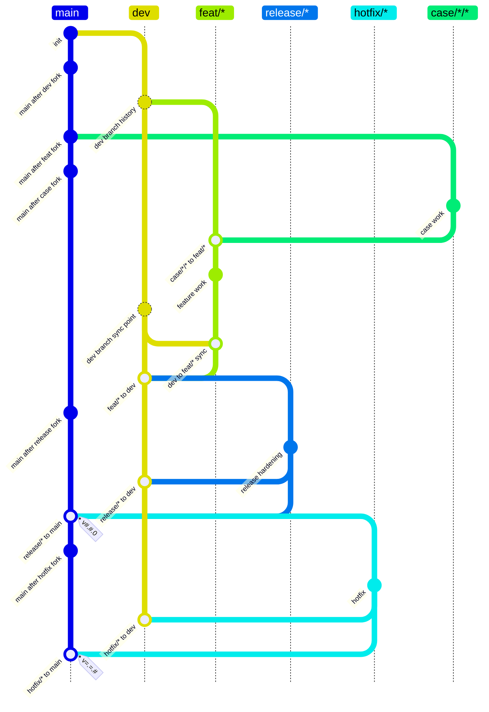

# Basic Feature Release Case Flow

## Rules

- `feat/*` branches from `dev`, must absorb the current `dev`, and merges to `dev`.
- `case/*/*` means `case/<context>/<topic>`, where `<context>` is a real project, customer, dataset, robot, deployment, or reproducible scenario.
- `case/*/*` branches from `main` and may merge only into `feat/*`.
- `case/*/*` must not merge directly into `dev` or `main`; reusable work must be distilled through `feat/*`.
- `release/*` branches from `dev`, must merge to `dev`, then merge to `main`; the `main` merge result must be tagged with `v#.#.0`.
- `hotfix/*` branches from `main`, must merge to `dev`, then merge to `main`; the `main` merge result must be tagged with `v=.=.#`.
- `dev` is the integration branch and must not receive direct commits after the policy is installed.
- `#` in tag patterns means one or more decimal digits.
- `=` in tag patterns means the same numeric component as the base release tag for this source branch.

## Workflow

`main` and `dev` are integration-only. Create short-lived `feat/*` or `case/*/*` branches before editing — always from the main worktree, because linked worktrees cannot create branches — and merge back through the declared flow. Never develop directly on a protected-branch checkout.

## Release safety

- Normal releases use `release/*` and lowercase three-part tags such as `v0.20.0`; patches use `hotfix/*` and tags such as `v0.20.1`. Existing uppercase two-part releases through `V0.19` remain immutable historical releases, not a new-release entry point.
- Maintainers prepare matching source versions and compiled catalog assets before the protected merge/tag. Only version-tag pushes start automatic publication; ordinary branch pushes do not.
- CI validates the exact existing tag commit against remote main history and source version, then tests, builds and distributes it. CI must not allocate versions, merge branches, write main/dev commits, or create/move tags.
- Generated release manifests are verified Release attachments, not post-build source commits. Explicit-tag retries reuse published bytes after main advances or temporary build artifacts expire.
- A release is complete only after all required artifacts are published and the formula-only Brew PR passes exact-head checks and merges. Failures remain visible; published tags and assets are never rewritten.
- Never overwrite files in users' installed Portmap packages as deployment. A hotfix is a versioned release, not a live patch.
- Publishing distributes packages only. Users explicitly upgrade through Homebrew or the authenticated web updater; CI never upgrades their machines.
