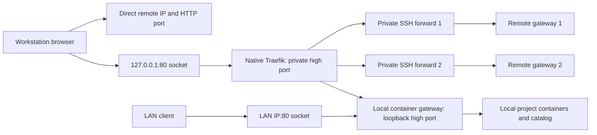

# portmap Architecture

`portmap` is a branch-scoped network control plane for local
docker-compose projects. It does not proxy traffic itself. It translates
project/branch rules into Docker Compose overlays, Traefik HTTP labels, Docker
direct port mappings, and a local CLI-queryable endpoint registry.

The default runtime shape is a host-side agent plus a shared gateway hosted by
the `portmap` tooling, not by each managed project. The host agent handles
host-only concerns such as Git worktree scanning and host-side compose starts.
It should stay small and integration-friendly: another local service can host
it, call it, or vendor it as a submodule without inheriting the full gateway UI.
The gateway runs Traefik for HTTP routing, CoreDNS for wildcard debug-domain
resolution, and the catalog UI. Managed project services with HTTP endpoints
join the shared Docker bridge network `portmap_gateway` through a generated
compose override. Raw TCP/UDP/range endpoints use direct Docker port mappings
and do not need the gateway network unless the same service also has an HTTP
endpoint.

## Container Runtime Abstraction

`portmap` supports one container runtime per host: Docker or Podman,
selected by `[runtime] backend` in `portmap.toml` (`auto` by default) or
`PORTMAP_RUNTIME` / `PORTMAP_RUNTIME_SOCKET`.

The abstraction is a single seam: the runtime's API socket. All compose
inspection and container lifecycle operations go through the docker
compose CLI pointed at the resolved socket via `DOCKER_HOST`, and the
gateway mounts that socket into Traefik and the catalog at the fixed
in-container path `/var/run/docker.sock`. The docker compose CLI remains
the client on Podman hosts because it preserves generated-override
semantics (`!reset`, label merge, external networks) that
`podman-compose` does not.

Auto-detection probes **live** sockets: an explicit `DOCKER_HOST`, then
`/var/run/docker.sock`, then `/run/podman/podman.sock`, then
`$XDG_RUNTIME_DIR/podman/podman.sock`. A socket path only counts when it
accepts a connection, so stale files from a stopped daemon are ignored.

The takeover shim resolves the runtime identically and doubles as
Podman's compose provider: Podman's provider search path includes
`$HOME/.docker/cli-plugins/docker-compose`, so the same user-level file
shadows both `docker compose` and `podman compose` invocations.

What does NOT change across runtimes: the planner, port allocation,
endpoint model, Traefik/CoreDNS data plane, generated labels, and the
catalog's label-derived registry. Rootless Podman is reachable through
the same socket discovery but requires host sysctl tuning for the
gateway's privileged ports; it was not part of the verification spike
([podman-spike.md](podman-spike.md)).

## Unified Local and Remote Access

The public executable is `portmap`. Local publishing and remote access are
optional roles of the same command, not separate server/client installations.
The frozen one-directory bundle includes Python, native CoreDNS/Traefik,
server/client modules, the host agent, gateway/demo/scaffold assets, and the
frontend. Client-only commands do not require a container runtime.

The frozen executable re-executes itself for catalog-view and host-agent
workers. Native/OS subprocesses receive an environment without bundle-specific
dynamic-library search paths. The shared state root is
`$XDG_STATE_HOME/portmap` (default `~/.local/state/portmap`); `client/` contains
access ownership, profiles and resolver state, while `server/` records local
publishing ownership and the effective runtime settings.

Exactly two remote transports are supported: direct IP reachability,
including existing LAN/Tailscale routing, and ordinary OpenSSH forwarding.
No Coder API, VPN implementation, or custom HTTP data plane is introduced.
Discovery inventories literal SSH aliases and static Include globs, not
unknown users, keys, or workspace names. Existing authentication,
ProxyCommand and ProxyJump remain authoritative.

Direct profiles resolve to the reachable IP verified on the workstation.
They retain the remote HTTP port and need no local HTTP gateway. Equivalent
default-port address spellings are normalized without weakening hostname-zone
collision checks.

SSH and local profiles resolve to loopback and share one public local HTTP
port, default 80. Each SSH remote has its own private high-port forward.
Native Traefik routes by HTTP Host; HTTP does not use TLS SNI.



The public LAN ingress never targets the native private-access gateway.
Enabling local publishing cannot expose SSH routes to other LAN clients.
Systemd binds only the exact requested addresses; DynamicUser
`systemd-socket-proxyd` services with empty capabilities forward to fixed
loopback targets. Unit changes use explicit sudo operations, not root
execution of user-writable portmap code. No sudoers, global low-port sysctl,
binary capabilities, or boot enablement are added. Conflicting listeners cause
an error, never a silent high-port fallback or a foreign-process shutdown.

The private native-backend forwarder uses a loopback-only cgroup IP policy
where the kernel supports it. The public container-backend forwarder does not:
Podman can DNAT the fixed loopback destination to a container bridge address,
which that policy would silently drop. Its exact listening address, fixed
target, DynamicUser and empty capability sets still apply.

CoreDNS serves only registered hostname zones. Linux setup creates an owned
dummy interface for `~portmap`, using `169.254.254.53:1053`; this also avoids
systemd-resolved 249's per-link loopback-server limitation. Physical/global
resolver configuration is unchanged. Dormant SSH profiles have no active DNS
mapping until restoration succeeds.

For SSH, the apex catalog projects client-visible URLs, while `/actions/*`
passes through to the remote catalog. Application subdomains preserve Host
and their own `/registry.json` is not intercepted. Local-domain catalogs and
actions pass directly to the local backend, including the private bare-IP
fallback; they are not replaced with a read-only remote view.

Connection state is private, serialized and atomically published. Failed
connect publication restores previous routes and removes the newly owned
tunnel. Disconnect leaves remote containers untouched. Stopping local
publishing preserves remote access; teardown refuses while local publishing
is active. Default-state setup can import the old `portmap-client` layout,
stopping only verified legacy workers and retaining saved targets/configuration.
Each stale SSH profile gets one explicit restoration attempt; failures are
reported without inventing a replacement identity.

Distribution uses `/api/downloads`, `/install.sh`, and
`/downloads/portmap/<filename>`. The Web offers standalone download/installation
and optional Homebrew install/upgrade, distinguishing installation from setup.
The old client-only endpoints and executable alias are removed.

`release.json` pins real versioned assets, size and SHA-256. Frozen installs
resolve an adjacent sidecar first, source/Brew use packaged metadata, and raw
bundles without metadata can fetch a bounded manifest from the version-pinned
trusted release. The archive never embeds its own checksum manifest: build
and installer write the sidecar separately. Invalid local metadata fails
honestly instead of selecting another release. Archive cache entries are
verified before serving. Canonical HTTPS GitHub URLs and trusted signed-CDN
redirects remain constrained; arbitrary hosts and credential-bearing URLs
are rejected. Installation itself changes no DNS, processes or listeners.

## Fixed Model

The default data plane is split by endpoint shape:

```text
HTTP / WebSocket / SSE / CDP / WebRTC signaling
  -> Traefik HTTP routers
  -> branch service:container_port

raw TCP / raw UDP
  -> Docker direct host port mapping
  -> branch service:container_port

dynamic port-range protocols
  -> project-owned service
  -> Docker direct mapping for one entry host port plus one branch-scoped host port range
```

`portmap` owns only the control-plane pieces:

- branch/project naming rules
- shared gateway network name
- wildcard debug DNS domain
- compose inspection
- endpoint discovery or declaration
- generated compose overlays
- generated Traefik labels for HTTP endpoints
- generated direct Docker port mappings for TCP, UDP, and range endpoints
- raw TCP/UDP host-port allocation
- range endpoint host-port allocation
- host Git worktree discovery through the host agent
- local endpoint registry
- status and cleanup metadata

It does not own:

- HTTP proxy implementation
- TCP/UDP proxy implementation
- range-like protocol implementation
- TURN credential generation
- ICE configuration
- WebRTC behavior
- application startup policy
- GPU/browser/MCP/debug workflow behavior

## Why Traefik

Traefik is the default because it can serve as one shared network data plane for:

- HTTP reverse proxy
- WebSocket reverse proxy
- SSE and streaming HTTP
- Docker label discovery
- TCP routers
- UDP routers
- dynamic container lifecycle updates

Caddy can still be a future HTTP/WebSocket-only backend, but v1 should not need
Caddy when Traefik is the default.

## Host Agent And Shared Gateway

```bash
portmap up
```

Local publishing needs a local Docker/Podman socket and Docker Compose CLI.
The host agent scans Git worktrees and handles host-side Compose operations.
Container-network Traefik, CoreDNS and the catalog retain direct access to the
runtime's project network, including rootless Podman networking.

The container gateway publishes only a loopback high HTTP port. Its catalog
listens on container port 8081 with no separate host publication. Traefik's
``HostRegexp(`.+`)`` fallback has explicit priority 1, below service Host
routes, so bare IPs and unmatched Hosts reach the local catalog. The
`portmap.gateway=true` label keeps infrastructure out of the project list and
project lifecycle controls.

The public HTTP port is separately advertised in endpoint metadata. The
native private-access gateway receives a local profile pointing at this
backend; the public LAN socket independently targets the same backend.
`http_bind = "0.0.0.0"` selects the detected LAN IPv4 address, not a wildcard
listener. Loopback-only configuration creates no public ingress.
There is no separate catalog-port configuration or single-port overlay.

`server/instance.json` records uid, effective settings, backend port and
access-state directory under a lock. Stop uses those saved settings, not
newly changed environment values. Up validates configuration, sets up the
access resolver, starts the agent/backend, publishes the local profile and
public ingress, and commits ownership. Failed first startup cleans new owned
resources; existing publishing state remains recoverable.
Down removes only that local role, public ingress, backend and agent.
SSH/direct profiles and any still-needed private HTTP ingress survive.

Background portmap workers inherit the invoking CLI user's credentials;
scope creation does not elevate them or enable boot services. On Linux, when that process sits in
a disposable logind `session-*.scope`, it first adopts its own PID into a
transient system-manager scope (one exact privileged `busctl
StartTransientUnit`, mode `fail`, `CollectMode=inactive-or-failed`) so the
workers survive the session that started them; outside such a session, and on
other platforms, nothing is attempted. Installing or upgrading portmap does
not restart or rescue workers that an earlier version left running. They must
stop and start again before the new lifetime rule applies; an idempotent
setup, up, connect, or agent start may reuse a running worker.

Source/Brew catalog containers import the packaged Python modules. Frozen
mode adds `docker-compose.frozen.yml`, mounting the complete bundle read-only
and running `portmap _serve-server-catalog` inside a glibc-compatible catalog
image. Frozen agent workers re-execute the unified executable rather than
assuming an external Python interpreter.

DNS and raw TCP/UDP/range endpoints remain separate from HTTP. Unified access
does not need remote port 53. Rootless runtimes can use an unprivileged
server DNS port without lowering the host's low-port threshold. Existing
project containers keep their endpoint labels until their generated override
is refreshed; the gateway cutover does not recreate those projects.

The gateway compose creates the named Docker network:

```text
portmap_gateway
```

Generated project overrides declare that network as external and attach managed
services to it:

```yaml
services:
  frontend:
    networks:
      default:
      portmap_gateway:
    labels:
      - traefik.enable=true
      - traefik.docker.network=portmap_gateway

networks:
  portmap_gateway:
    external: true
    name: portmap_gateway
```

This keeps Traefik out of individual project compose files while still allowing
Traefik to reach Docker bridge services without per-service host port mappings.

Workstations use `portmap setup` and `portmap connect`, not physical-interface
DNS rewrites or per-endpoint hosts entries. The separately exposed server DNS
listener is for explicit DNS/container consumers, not the unified client
transport. The advanced `portmap dns set/unset` drop-in utility is independent
of the access resolver and is not invoked by setup.

## Endpoint Classes

`portmap` should classify exposed services into four endpoint classes.

### `http`

Examples:

- frontend dev server
- backend HTTP API
- CDP HTTP/WebSocket
- MCP over HTTP/WebSocket/SSE
- WebRTC signaling

HTTP endpoints can share one Traefik HTTP entrypoint because Traefik can route
by HTTP `Host`.

By default, generated HTTP routers rewrite the upstream request `Host` header
to:

```text
127.0.0.1:<container_port>
```

This is a generic HTTP proxy policy, not a CDP-specific rule. It makes local
debug services that reject arbitrary external Host headers work behind the
shared debug domain. Endpoint declarations can opt out when the application
needs to observe the external Host:

```toml
[endpoints.frontend]
kind = "http"
service = "frontend"
container_port = 5173
preserve_host = true
```

They can also set a specific upstream Host:

```toml
[endpoints.browser_debug]
kind = "http"
service = "browser"
container_port = 19333
upstream_host = "127.0.0.1:19333"
```

Example generated labels:

```yaml
services:
  frontend:
    labels:
      - traefik.enable=true
      - traefik.http.routers.comap-feat-a-frontend.rule=Host(`frontend.feat-a.comap.debug.lan`)
      - traefik.http.routers.comap-feat-a-frontend.entrypoints=web
      - traefik.http.services.comap-feat-a-frontend.loadbalancer.server.port=5173
      - traefik.http.routers.comap-feat-a-frontend.middlewares=comap-feat-a-frontend-host
      - traefik.http.middlewares.comap-feat-a-frontend-host.headers.customrequestheaders.Host=127.0.0.1:5173
      - traefik.docker.network=portmap_gateway
```

Request path:

```text
browser
  -> http://frontend.feat-a.comap.example-host.portmap
  -> Traefik web entrypoint
  -> portmap_gateway
  -> frontend container:5173
```

The browser needs the URL, not the container port.

### `range`

Examples:

- TURN/coturn
- SIP plus RTP
- RTSP plus RTP/RTCP
- FTP passive mode

Range endpoints model protocols with one entry/control port and a later
runtime-selected data/media port range. `portmap` does not understand the
protocol; it only allocates the external entry port and the contiguous host port
range, then writes both into the generated compose override.

The important resource is the port pool and its index:

```text
repo + worktree root + branch + endpoint -> entry port + range
```

Protocol-specific behavior stays outside `portmap`.

Example declaration:

```toml
[endpoints.turn]
kind = "range"
service = "coturn"
container_port = 3478
protocol = "udp"
range_size = 40
```

Example generated compose shape:

```yaml
services:
  coturn:
    ports:
      - "34781:3478/udp"
      - "49160-49199:49160-49199/udp"
    environment:
      PORTMAP_TURN_HOST: "<detected-host-ip>"
      PORTMAP_TURN_PORT: "34781"
      PORTMAP_TURN_PROTOCOL: "udp"
      PORTMAP_TURN_RANGE_MIN_PORT: "49160"
      PORTMAP_TURN_RANGE_MAX_PORT: "49199"
      PORTMAP_TURN_RANGE_SIZE: "40"
```

The range uses same-number host/container mapping. This is deliberate because
protocols such as TURN advertise selected relay ports to external clients; the
project service must be configured to listen on the injected range.

All services referenced by `endpoints.toml` receive the generated
`PORTMAP_<ENDPOINT>_*` variables. This stays generic while allowing one service
to consume another endpoint's externally assigned address, for example a browser
service reading `PORTMAP_TURN_*` to publish TURN details.

### `tcp`

Examples:

- MQTT
- Postgres
- Redis
- MySQL
- custom TCP services

Raw TCP usually cannot share one entrypoint by hostname because it has no HTTP
`Host` header. TLS TCP with SNI is an exception, but v1 should not rely on it.

For raw TCP, `portmap` allocates a host port and writes a Docker direct port
mapping.

Example generated override:

```yaml
services:
  mqtt:
    ports:
      - "18831:1883/tcp"
    environment:
      PORTMAP_MQTT_HOST: "<detected-host-ip>"
      PORTMAP_MQTT_PORT: "18831"
      PORTMAP_MQTT_PROTOCOL: "tcp"
    labels:
      - portmap.managed=true
      - portmap.endpoints.comap-feat-a-mqtt.kind=tcp
      - portmap.endpoints.comap-feat-a-mqtt.host=<detected-host-ip>
      - portmap.endpoints.comap-feat-a-mqtt.host_port=18831
```

Request path:

```text
mqtt client
  -> 127.0.0.1:18831
  -> mqtt container:1883
```

The service container usually does not need to know the external host port. The
client does, so the port must be written to the registry.

### `udp`

Examples:

- custom UDP services
- coturn/TURN UDP ports when the project owns coturn

Raw UDP also needs allocated host ports. It uses Docker direct port mapping in
v1.

Example generated override:

```yaml
services:
  udp-service:
    ports:
      - "19991:9999/udp"
    environment:
      PORTMAP_UDP_HOST: "<detected-host-ip>"
      PORTMAP_UDP_PORT: "19991"
      PORTMAP_UDP_PROTOCOL: "udp"
    labels:
      - portmap.managed=true
      - portmap.endpoints.comap-feat-a-udp.kind=udp
      - portmap.endpoints.comap-feat-a-udp.host=<detected-host-ip>
      - portmap.endpoints.comap-feat-a-udp.host_port=19991
```

## TURN Boundary

TURN is not a core `portmap` concept.

`portmap` should not generate TURN credentials, ICE configs, or
WebRTC application settings. If a project runs coturn, the tool treats it like
ordinary TCP/UDP endpoints.

The WebRTC application remains responsible for using and exposing its own
`iceServers` configuration, for example through env vars, config files, or a
`/turn`/`/rtc-config` endpoint.

Two valid project-level patterns:

```text
shared coturn:
  all branches use turn:<host>:3478

per-branch coturn:
  branch-a uses turn:<host>:34781
  branch-b uses turn:<host>:34782
```

`portmap` only records and exposes whichever external TCP/UDP ports
the project chooses.

## Compose Inspection

The tool should inspect rendered Compose output, preferably via:

```bash
docker compose config --format json
```

It should read:

- services
- networks
- `network_mode`
- `ports`
- `expose`
- existing labels
- compose project name

Rules:

- reject or warn on `network_mode: host` for managed endpoints
- allow normal Docker bridge networks
- prefer explicit endpoint declarations over guessing
- treat `ports` and `expose` as endpoint candidates
- generate explicit `loadbalancer.server.port` labels instead of relying on Traefik port guessing

## Repository Identity

`portmap` should distinguish repositories by Git history, not by
directory name, branch name, or current commit.

Default repo identity:

```text
repo_id = hash(first_commit_hash)
```

This means these are treated as the same repo:

- different branches of the same Git history
- different worktrees of the same Git history
- different clones of the same Git history

This is intentional. For this tool, "same repo" means "same code history root",
not necessarily "same hosting-provider project".

Human display names can still come from the directory name or remote basename:

```text
repo_id = hash(first_commit_hash)
display_name = basename(remote_url or git_root)
```

Users may override the identity explicitly:

```toml
# .portmap/repo.toml
repo_id = "comap"
display_name = "comap"
```

Resolution order:

```text
1. explicit .portmap/repo.toml repo_id
2. hash(first_commit_hash)
3. hash(git_root_path) as fallback when the first commit is unavailable
```

Known boundaries:

- shallow clones may not contain the first commit
- history rewriting with tools such as filter-repo can change the first commit
- forks with the same root commit are intentionally grouped unless `repo_id` is
  explicitly overridden

## Generated Artifacts

Generated files should live under:

```text
.portmap/
  endpoints.toml
  README.md
  .gitignore
  docker-compose.override.generated.yml
  state.json
```

`endpoints.toml` is the project-local source of truth. The generated compose
override is the only project-local artifact required for HTTP endpoints because
Traefik and the catalog both read Docker labels from running containers.
`state.json` is branch/worktree-local generated state. It records the generated
compose project name and endpoint identity for the broker.

`portmap init` creates `.portmap/endpoints.toml`, `.portmap/README.md`, and
`.portmap/.gitignore`. The README is deliberately project-local: it documents
how this compose repo should be shaped for portmap to manage it, how endpoint
kinds map to HTTP/raw/range routing, how to generate the branch-specific
override, and how to query the shared catalog. `portmap generate` should also
add the README and `.gitignore` when they are missing, but it should not
overwrite existing project-local docs.

Raw TCP/UDP endpoints may need additional generated state because they consume
host ports:

```text
~/.local/state/portmap/allocations.json
```

This allocation pool is host-wide, not branch state. It prevents two worktrees
from picking the same raw/range host port before Docker has bound either port.
If a caller explicitly chooses project-local allocation state, that file may be
stored as `.portmap/allocations.json`.

Extra Traefik static config should only exist when a runtime mode needs it. It
should not be generated as an empty file for HTTP-only projects.

The original project files should not be modified in v1:

- do not rewrite `docker-compose.yml`
- do not rewrite `.env`
- do not remove existing `ports`

## Catalog And Query

The shared gateway catalog is a core feature. It answers:

```text
which repos are running
which branch/worktree instances exist
which endpoints each instance exposes
which URL or host:port each endpoint uses
```

The catalog is derived from Docker/Podman labels on running containers. It has
no host-port mapping of its own; the backend Traefik fallback serves it through
the controlled public or private HTTP entry:

```text
http://example-host.portmap/
http://example-host.portmap/registry.json
```

Minimal JSON shape:

```json
{
  "services": [
    {
      "repo_name": "comap",
      "branch": "feat-a",
      "worktree": "/home/ylang/ylangs_ws/comap@worktree/comap@feat-a",
      "compose_project": "comap_feat_a",
      "compose_service": "frontend",
      "endpoints": [
        {
          "name": "frontend",
          "kind": "http",
          "url": "http://frontend.feat-a.comap.example-host.portmap"
        },
        {
          "name": "mqtt",
          "kind": "tcp",
          "host": "127.0.0.1",
          "host_port": 18831
        }
      ]
    }
  ]
}
```

Project-local `.portmap/registry.json` is intentionally not required in the
default model. It duplicates Docker labels and can become stale when containers
are stopped or recreated.

Future CLI query commands should read the shared catalog by default:

```bash
portmap list
portmap status
portmap endpoints <repo> <instance>
```

## Design Rule

If a concern can be expressed as:

```text
branch instance + endpoint kind + container port -> external URL or host port
```

it belongs in `portmap`.

If a concern depends on WebRTC ICE behavior, TURN credentials, business flows,
GPU/browser runtime, MCP tool semantics, or application internals, it belongs
to the project or a higher-level debug workflow.

Open implementation items are tracked in [todos.md](todos.md).
