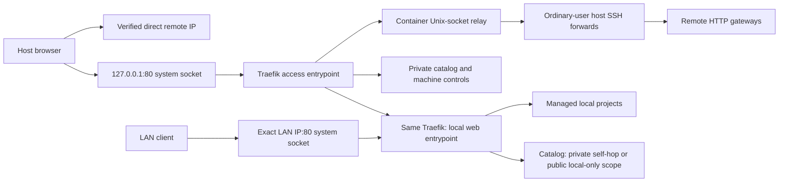

# portmap Architecture

`portmap` is a branch-scoped network control plane for local
docker-compose projects. It does not proxy traffic itself. It translates
project/branch rules into Docker Compose overlays, Traefik HTTP labels, Docker
direct port mappings, and a local CLI-queryable endpoint registry.

The runtime is one shared container stack plus a small ordinary-user host
agent. CoreDNS, Traefik, the catalog, and an SSH Unix-socket relay run in
containers, including on remote-only clients. The host retains the CLI,
worktree/Compose agent, OpenSSH workers, and narrowly scoped DNS/ingress
integration. There is no native DNS or HTTP fallback.
Every managed service consuming Portmap DNS joins the gateway bridge through
the generated Compose override. HTTP routes use Traefik; raw TCP/UDP/ranges
still use direct runtime port mappings, not the HTTP gateway.

## Container Runtime Abstraction

`portmap` supports one container runtime per host: Docker or Podman,
selected by `[runtime] backend` in `portmap.toml` (`auto` by default) or
`PORTMAP_RUNTIME` / `PORTMAP_RUNTIME_SOCKET`.

The common seam is the runtime API socket. The controller uses it for
resource inspection and ownership-checked operations; Docker Compose applies
the generated stack with `DOCKER_HOST` pointing at the same endpoint.
Traefik and the catalog mount that socket at `/var/run/docker.sock`.
Docker Compose remains the client on Podman hosts because it preserves
generated-override semantics (`!reset`, label merge, external networks) that
`podman-compose` does not.

Auto-detection respects an explicit `DOCKER_HOST`, then probes a live Docker
socket, then rootless Podman (`$XDG_RUNTIME_DIR/podman/podman.sock`, defaulting
to `/run/user/<uid>/podman/podman.sock`), then the rootful Podman socket.
Explicit backend/socket configuration takes precedence. Infrastructure requires
a local Unix socket; remote machine access goes through direct or SSH profiles.

The takeover shim sends managed projects through the unified CLI and doubles
as Podman's Compose provider: its provider search includes
`$HOME/.docker/cli-plugins/docker-compose`.

The planner, endpoint model, labels, DNS/route generation, ownership and
rollback rules are shared. Compatibility APIs are not treated as equivalent
networking or privilege behavior: the controller reads Podman's native
rootless flag and maps container file ownership accordingly. Rootless
containers use unprivileged host bindings; restricted systemd sockets own
HTTP 80. No low-port sysctl, binary capabilities, linger or logind policy change
is part of setup. [podman-spike.md](podman-spike.md) is historical evidence,
not acceptance evidence for the current rootless implementation.

## Unified Local and Remote Access

The public executable is `portmap`. Local publishing and remote access are
optional roles of the same command, not separate installations. The frozen
one-directory bundle includes Python, the CLI/agent, access and publishing
modules, infrastructure/demo/scaffold assets, and frontend. It does not contain
host CoreDNS or Traefik executables. Setup always requires a working runtime
and Docker Compose. Standalone installation alone starts nothing; the Brew
formula also performs setup against an existing accessible runtime API.

The frozen executable re-executes itself for the host agent and inside the
catalog container. Native/OS subprocesses receive an environment without
bundle-specific dynamic-library paths. The shared state root is
`$XDG_STATE_HOME/portmap` (default `~/.local/state/portmap`); `client/` contains
profiles, desired connection configuration, resolver and infrastructure
ownership, while `server/` records the optional local publishing role.

Exactly two remote transports are supported: direct IP reachability,
including existing LAN/Tailscale routing, and ordinary OpenSSH forwarding.
No Coder API, VPN implementation, or custom HTTP data plane is introduced.
Discovery inventories literal SSH aliases and static Include globs, not
unknown users, keys, or workspace names. Existing authentication,
ProxyCommand and ProxyJump remain authoritative.

Direct profiles resolve to the reachable IP verified on the workstation.
They retain the remote HTTP port and bypass the local HTTP gateway. Equivalent
default-port address spellings are normalized without weakening hostname-zone
collision checks.

Setup always prepares split DNS and the private `127.0.0.1:80` entry.
An empty profile set, direct-only access and the last disconnect retain this
entry. Only explicit teardown releases it, after local publishing has stopped.
Setup neither starts application projects nor enables LAN ingress or boot units.

SSH and local host profiles resolve to loopback and share private HTTP port 80.
Each SSH remote has a private host Unix-socket forward mounted read-only into
the container relay. Container clients resolve those zones to Traefik's bridge
address instead of unusable host loopback. Routing uses HTTP Host, not TLS SNI.



The LAN ingress never targets the private access entrypoint. The public
catalog does not serve imported machines, connection controls, or SSH names.
Systemd binds only the exact requested addresses; DynamicUser
`systemd-socket-proxyd` services with empty capabilities forward to fixed
loopback targets. Unit changes use explicit sudo operations, not root
execution of user-writable portmap code. No sudoers, global low-port sysctl,
binary capabilities, or boot enablement are added. Conflicting listeners cause
an error, never a silent high-port fallback or a foreign-process shutdown.

Both HTTP backends are container-published loopback ports. Rootless Podman can
DNAT them to bridge addresses, so the forwarders do not impose a loopback-only
cgroup IP filter that would silently drop legitimate traffic. Exact socket
addresses, fixed targets, DynamicUser and empty capability sets still apply.

CoreDNS separates host, container and legacy-public views. Linux setup creates
an owned dummy interface and a systemd-resolved `~portmap` route using
`169.254.254.53:1053`. Project containers use the fixed CoreDNS bridge address
at port 53; their SSH/local answers point at Traefik's bridge address.
An existing legacy-public DNS view is preserved independently and never
inherits private SSH routes. Physical/global DNS settings are unchanged.
Applications must already reach systemd-resolved through NSS or its stub;
Portmap neither edits `/etc/nsswitch.conf` nor `/etc/resolv.conf`.
Dormant SSH profiles have no active DNS mapping until restoration succeeds.

The private catalog selects local or remote machines explicitly. Remote
registries are fetched through the selected transport and projected into
client-visible links; `/actions/*` targets that same machine. Unknown or
unavailable selections fail rather than falling back to local. Application
subdomains preserve Host and do not have `/registry.json` intercepted.
Connection mutations require a same-origin JSON request, including a matching
HTTP port; the public catalog cannot invoke them.

Connection state is private, serialized and atomically published. Failed
connect publication restores previous routes and removes the newly owned
tunnel. Disconnect leaves remote containers untouched. Stopping local
publishing preserves remote access; teardown refuses while local publishing
is active. Default-state setup can import the old `portmap-client` layout.
Both imported and in-place native profiles preserve a verified live SSH master:
the Unix HTTP forward and published route are proved before the exact old HTTP
forward is cancelled. Saved authentication, custom remote ports and raw TCP
forwards remain intact. Dead masters receive one explicit restoration attempt;
failures are reported without inventing a replacement identity.

Relay startup renders the desired private Unix-socket endpoints before HAProxy
loads its first worker; startup does not depend on an early reload signal.
Recreated infrastructure must load its saved revision before a live update.
DNS and public HTTP publication remain gated on the desired revision.
A native worker holding the requested private HTTP port is released only after
the replacement route is proved. Its captured command and paired ownership
records are restored on a pre-commit interruption; unrelated listeners remain
outside the transaction.

Distribution uses `/api/downloads`, `/install.sh`, and
`/downloads/portmap/<filename>`. The Web distinguishes standalone installation,
which requires a later setup, from Homebrew installation, which waits for
successful setup and the loopback page. Neither installs or starts a container
engine. The old client-only endpoints and executable alias are removed.

`release.json` pins real versioned assets, size and SHA-256. Frozen installs
resolve an adjacent sidecar first, source/Brew use packaged metadata, and raw
bundles without metadata can fetch a bounded manifest from the version-pinned
trusted release. The archive never embeds its own checksum manifest: build
and installer write the sidecar separately. Invalid local metadata fails
honestly instead of selecting another release. Archive cache entries are
verified before serving. Canonical HTTPS GitHub URLs and trusted signed-CDN
redirects remain constrained; arbitrary hosts and credential-bearing URLs
are rejected. Standalone installation itself changes no DNS, processes or
listeners. Brew activates its setup helper through the ordinary user's service
manager, preserving Homebrew's package-install sandbox. Failure propagates back
to the Brew command instead of reporting a ready gateway.

## Fixed Model

The default data plane is split by endpoint shape:

```text
HTTP / WebSocket / SSE / CDP / WebRTC signaling
  -> Traefik HTTP routers
  -> branch service:container_port

raw TCP / raw UDP
  -> Docker direct host port mapping
  -> branch service:container_port

dynamic port-range protocols
  -> project-owned service
  -> Docker direct mapping for one entry host port plus one branch-scoped host port range
```

`portmap` owns only the control-plane pieces:

- branch/project naming rules
- shared gateway network name
- wildcard debug DNS domain
- compose inspection
- endpoint discovery or declaration
- generated compose overlays
- generated Traefik labels for HTTP endpoints
- generated direct Docker port mappings for TCP, UDP, and range endpoints
- raw TCP/UDP host-port allocation
- range endpoint host-port allocation
- host Git worktree discovery through the host agent
- local endpoint registry
- status and cleanup metadata

It does not own:

- HTTP proxy implementation
- TCP/UDP proxy implementation
- range-like protocol implementation
- TURN credential generation
- ICE configuration
- WebRTC behavior
- application startup policy
- GPU/browser/MCP/debug workflow behavior

## Why Traefik

Traefik is the default because it can serve as one shared network data plane for:

- HTTP reverse proxy
- WebSocket reverse proxy
- SSE and streaming HTTP
- Docker label discovery
- TCP routers
- UDP routers
- dynamic container lifecycle updates

Caddy can still be a future HTTP/WebSocket-only backend, but v1 should not need
Caddy when Traefik is the default.

## Host Agent And Shared Gateway

```bash
portmap up
```

Local publishing uses the already prepared container stack and host agent.
The agent scans Git worktrees and performs host-side Compose operations;
Traefik, CoreDNS and the catalog retain gateway-network access on both Docker
and rootless Podman.

The gateway publishes three distinct loopback high ports: private access,
local web, and management/readiness. The catalog's private/public listeners
have no independent host publication. On the web entrypoint, application Host
routes outrank catalog fallbacks. A private self-hop from Traefik's own
container loopback selects the private catalog; public ingress cannot supply
that TCP source address. Other web traffic selects the local-only public
catalog. The `portmap.gateway=true` label excludes infrastructure from project
lists and lifecycle controls.

The public HTTP port is advertised separately from these backend ports.
Only an explicit non-loopback IPv4/IPv6 `http_bind` creates LAN ingress;
wildcards and loopback-only configuration create none. The LAN socket targets
the web backend, never the private access backend.

`server/instance.json` records uid, effective settings, backend port and
access-state directory under a lock. Stop uses saved settings, not a changed
shell environment. Up prepares/reuses infrastructure, publishes the local
role and optional LAN ingress, then commits ownership. A failed first startup
cleans only newly owned resources; existing publishing state stays recoverable.
Down removes the local role and public ingress, not the shared stack or agent.
SSH/direct profiles and private HTTP/DNS survive. Teardown releases access
infrastructure only after local publishing has stopped, and retains networks
still consumed by business containers.

Background portmap workers inherit the invoking CLI user's credentials;
scope creation does not elevate them or enable boot services. On Linux, a CLI
in a logind `session-*.scope` or a per-user manager cgroup adopts only its own
PID into a transient system-manager scope (one exact privileged `busctl
StartTransientUnit`, mode `fail`, `CollectMode=inactive-or-failed`). Workers
therefore survive both the caller's session and an installer/user service
ending, without enabling linger. Processes already in a system service need
no move. Replacing a standalone bundle or source tree alone does not rescue
old workers; Brew runs setup, which can still reuse compatible live workers.

Source/Brew catalog containers mount packaged Python modules read-only.
The catalog's Compose configuration includes the bind-source device/inode
identity. Replacing a keg at the same pathname therefore recreates only the
catalog before Brew removes the old directory; unchanged mounts do not cause
recreation. The access indicator uses the selected machine's canonical catalog
URL rather than inventing a publishing-only hostname for setup-only clients.
Frozen mode uses the same generated Compose model, mounting the complete
bundle read-only and executing `portmap _serve-catalog` in a compatible image.
Host agent workers re-execute that executable rather than assuming an external
Python installation. There is no alternate frozen Compose stack.

DNS and raw TCP/UDP/ranges remain separate from HTTP; unified access needs no
remote port 53. Existing business containers, their endpoint labels and DNS
addresses survive migration. Generated overrides change only when the project
is explicitly regenerated; infrastructure cutover does not recreate projects.

The controller creates or validates the shared bridge network (default):

```text
portmap_gateway
```

Newly owned bridges enable IPv4 and IPv6 through the runtime's native IPAM.
Existing bridges retain their configuration and consumers. An IPv6 direct
profile requires an IPv6-enabled bridge before routes or DNS are published;
the controller does not rebuild an existing IPv4-only network behind running
projects. Direct traffic remains native IP traffic, not a relay workaround.

Generated project overrides declare that network as external and attach managed
services to it:

```yaml
services:
  frontend:
    networks:
      default:
      portmap_gateway:
    labels:
      - traefik.enable=true
      - traefik.docker.network=portmap_gateway

networks:
  portmap_gateway:
    external: true
    name: portmap_gateway
```

This keeps Traefik out of individual project compose files while still allowing
Traefik to reach Docker bridge services without per-service host port mappings.

Workstations use `portmap setup` and `portmap connect`, not physical-interface
DNS rewrites or per-endpoint hosts entries. Containers use the shared bridge
DNS address. A migrated server's existing external DNS binding is preserved
only for its prior consumers, not for the unified client transport.
The advanced `portmap dns set/unset` drop-in utility is independent of the
access resolver and is not invoked by setup.

## Endpoint Classes

`portmap` should classify exposed services into four endpoint classes.

### `http`

Examples:

- frontend dev server
- backend HTTP API
- CDP HTTP/WebSocket
- MCP over HTTP/WebSocket/SSE
- WebRTC signaling

HTTP endpoints can share one Traefik HTTP entrypoint because Traefik can route
by HTTP `Host`.

By default, generated HTTP routers rewrite the upstream request `Host` header
to:

```text
127.0.0.1:<container_port>
```

This is a generic HTTP proxy policy, not a CDP-specific rule. It makes local
debug services that reject arbitrary external Host headers work behind the
shared debug domain. Endpoint declarations can opt out when the application
needs to observe the external Host:

```toml
[endpoints.frontend]
kind = "http"
service = "frontend"
container_port = 5173
preserve_host = true
```

They can also set a specific upstream Host:

```toml
[endpoints.browser_debug]
kind = "http"
service = "browser"
container_port = 19333
upstream_host = "127.0.0.1:19333"
```

Internal router, service, and middleware names include the repository ID,
branch, and worktree identity so equally named projects do not collide in
Traefik. Public hostnames keep their human-readable names. Example labels:

```yaml
services:
  frontend:
    labels:
      - traefik.enable=true
      - traefik.http.routers.c8120ac634d1-feat-a-e19f736c-frontend.rule=Host(`frontend.feat-a.comap.debug.lan`)
      - traefik.http.routers.c8120ac634d1-feat-a-e19f736c-frontend.entrypoints=web
      - traefik.http.services.c8120ac634d1-feat-a-e19f736c-frontend.loadbalancer.server.port=5173
      - traefik.http.routers.c8120ac634d1-feat-a-e19f736c-frontend.middlewares=c8120ac634d1-feat-a-e19f736c-frontend-host
      - traefik.http.middlewares.c8120ac634d1-feat-a-e19f736c-frontend-host.headers.customrequestheaders.Host=127.0.0.1:5173
      - traefik.docker.network=portmap_gateway
```

Request path:

```text
browser
  -> http://frontend.feat-a.comap.example-host.portmap
  -> Traefik web entrypoint
  -> portmap_gateway
  -> frontend container:5173
```

The browser needs the URL, not the container port.

### `range`

Examples:

- TURN/coturn
- SIP plus RTP
- RTSP plus RTP/RTCP
- FTP passive mode

Range endpoints model protocols with one entry/control port and a later
runtime-selected data/media port range. `portmap` does not understand the
protocol; it only allocates the external entry port and the contiguous host port
range, then writes both into the generated compose override.

The important resource is the port pool and its index:

```text
repo + worktree root + branch + endpoint -> entry port + range
```

Protocol-specific behavior stays outside `portmap`.

Example declaration:

```toml
[endpoints.turn]
kind = "range"
service = "coturn"
container_port = 3478
protocol = "udp"
range_size = 40
```

Example generated compose shape:

```yaml
services:
  coturn:
    ports:
      - "34781:3478/udp"
      - "49160-49199:49160-49199/udp"
    environment:
      PORTMAP_TURN_HOST: "<detected-host-ip>"
      PORTMAP_TURN_PORT: "34781"
      PORTMAP_TURN_PROTOCOL: "udp"
      PORTMAP_TURN_RANGE_MIN_PORT: "49160"
      PORTMAP_TURN_RANGE_MAX_PORT: "49199"
      PORTMAP_TURN_RANGE_SIZE: "40"
```

The range uses same-number host/container mapping. This is deliberate because
protocols such as TURN advertise selected relay ports to external clients; the
project service must be configured to listen on the injected range.

All services referenced by `endpoints.toml` receive the generated
`PORTMAP_<ENDPOINT>_*` variables. This stays generic while allowing one service
to consume another endpoint's externally assigned address, for example a browser
service reading `PORTMAP_TURN_*` to publish TURN details.

### `tcp`

Examples:

- MQTT
- Postgres
- Redis
- MySQL
- custom TCP services

Raw TCP usually cannot share one entrypoint by hostname because it has no HTTP
`Host` header. TLS TCP with SNI is an exception, but v1 should not rely on it.

For raw TCP, `portmap` allocates a host port and writes a Docker direct port
mapping.

Example generated override:

```yaml
services:
  mqtt:
    ports:
      - "18831:1883/tcp"
    environment:
      PORTMAP_MQTT_HOST: "<detected-host-ip>"
      PORTMAP_MQTT_PORT: "18831"
      PORTMAP_MQTT_PROTOCOL: "tcp"
    labels:
      - portmap.managed=true
      - portmap.endpoints.comap-feat-a-mqtt.kind=tcp
      - portmap.endpoints.comap-feat-a-mqtt.host=<detected-host-ip>
      - portmap.endpoints.comap-feat-a-mqtt.host_port=18831
```

Request path:

```text
mqtt client
  -> 127.0.0.1:18831
  -> mqtt container:1883
```

The service container usually does not need to know the external host port. The
client does, so the port must be written to the registry.

### `udp`

Examples:

- custom UDP services
- coturn/TURN UDP ports when the project owns coturn

Raw UDP also needs allocated host ports. It uses Docker direct port mapping in
v1.

Example generated override:

```yaml
services:
  udp-service:
    ports:
      - "19991:9999/udp"
    environment:
      PORTMAP_UDP_HOST: "<detected-host-ip>"
      PORTMAP_UDP_PORT: "19991"
      PORTMAP_UDP_PROTOCOL: "udp"
    labels:
      - portmap.managed=true
      - portmap.endpoints.comap-feat-a-udp.kind=udp
      - portmap.endpoints.comap-feat-a-udp.host=<detected-host-ip>
      - portmap.endpoints.comap-feat-a-udp.host_port=19991
```

## TURN Boundary

TURN is not a core `portmap` concept.

`portmap` should not generate TURN credentials, ICE configs, or
WebRTC application settings. If a project runs coturn, the tool treats it like
ordinary TCP/UDP endpoints.

The WebRTC application remains responsible for using and exposing its own
`iceServers` configuration, for example through env vars, config files, or a
`/turn`/`/rtc-config` endpoint.

Two valid project-level patterns:

```text
shared coturn:
  all branches use turn:<host>:3478

per-branch coturn:
  branch-a uses turn:<host>:34781
  branch-b uses turn:<host>:34782
```

`portmap` only records and exposes whichever external TCP/UDP ports
the project chooses.

## Compose Inspection

The tool should inspect rendered Compose output, preferably via:

```bash
docker compose config --format json
```

It should read:

- services
- networks
- `network_mode`
- `ports`
- `expose`
- existing labels
- compose project name

Rules:

- reject or warn on `network_mode: host` for managed endpoints
- allow normal Docker bridge networks
- prefer explicit endpoint declarations over guessing
- treat `ports` and `expose` as endpoint candidates
- generate explicit `loadbalancer.server.port` labels instead of relying on Traefik port guessing

## Repository Identity

`portmap` should distinguish repositories by Git history, not by
directory name, branch name, or current commit.

Default repo identity:

```text
repo_id = hash(first_commit_hash)
```

This means these are treated as the same repo:

- different branches of the same Git history
- different worktrees of the same Git history
- different clones of the same Git history

This is intentional. For this tool, "same repo" means "same code history root",
not necessarily "same hosting-provider project".

Human display names can still come from the directory name or remote basename:

```text
repo_id = hash(first_commit_hash)
display_name = basename(remote_url or git_root)
```

Users may override the identity explicitly:

```toml
# .portmap/repo.toml
repo_id = "comap"
display_name = "comap"
```

Resolution order:

```text
1. explicit .portmap/repo.toml repo_id
2. hash(first_commit_hash)
3. hash(git_root_path) as fallback when the first commit is unavailable
```

Known boundaries:

- shallow clones may not contain the first commit
- history rewriting with tools such as filter-repo can change the first commit
- forks with the same root commit are intentionally grouped unless `repo_id` is
  explicitly overridden

## Generated Artifacts

Generated files should live under:

```text
.portmap/
  endpoints.toml
  README.md
  .gitignore
  docker-compose.override.generated.yml
  state.json
```

`endpoints.toml` is the project-local source of truth. The generated compose
override is the only project-local artifact required for HTTP endpoints because
Traefik and the catalog both read Docker labels from running containers.
`state.json` is branch/worktree-local generated state. It records the generated
compose project name and endpoint identity for the broker.

`portmap init` creates `.portmap/endpoints.toml`, `.portmap/README.md`, and
`.portmap/.gitignore`. The README is deliberately project-local: it documents
how this compose repo should be shaped for portmap to manage it, how endpoint
kinds map to HTTP/raw/range routing, how to generate the branch-specific
override, and how to query the shared catalog. `portmap generate` should also
add the README and `.gitignore` when they are missing, but it should not
overwrite existing project-local docs.

Raw TCP/UDP endpoints may need additional generated state because they consume
host ports:

```text
~/.local/state/portmap/allocations.json
```

This allocation pool is host-wide, not branch state. It prevents two worktrees
from picking the same raw/range host port before Docker has bound either port.
If a caller explicitly chooses project-local allocation state, that file may be
stored as `.portmap/allocations.json`.

Extra Traefik static config should only exist when a runtime mode needs it. It
should not be generated as an empty file for HTTP-only projects.

The original project files should not be modified in v1:

- do not rewrite `docker-compose.yml`
- do not rewrite `.env`
- do not remove existing `ports`

## Catalog And Query

The shared gateway catalog is a core feature. It answers:

```text
which repos are running
which branch/worktree instances exist
which endpoints each instance exposes
which URL or host:port each endpoint uses
```

The catalog is derived from Docker/Podman labels on running containers. It has
no host-port mapping of its own; the backend Traefik fallback serves it through
the controlled public or private HTTP entry:

```text
http://example-host.portmap/
http://example-host.portmap/registry.json
```

Minimal JSON shape:

```json
{
  "services": [
    {
      "repo_name": "comap",
      "branch": "feat-a",
      "worktree": "/home/ylang/ylangs_ws/comap@worktree/comap@feat-a",
      "compose_project": "comap_feat_a",
      "compose_service": "frontend",
      "endpoints": [
        {
          "name": "frontend",
          "kind": "http",
          "url": "http://frontend.feat-a.comap.example-host.portmap"
        },
        {
          "name": "mqtt",
          "kind": "tcp",
          "host": "127.0.0.1",
          "host_port": 18831
        }
      ]
    }
  ]
}
```

Project-local `.portmap/registry.json` is intentionally not required in the
default model. It duplicates Docker labels and can become stale when containers
are stopped or recreated.

Future CLI query commands should read the shared catalog by default:

```bash
portmap list
portmap status
portmap endpoints <repo> <instance>
```

## Design Rule

If a concern can be expressed as:

```text
branch instance + endpoint kind + container port -> external URL or host port
```

it belongs in `portmap`.

If a concern depends on WebRTC ICE behavior, TURN credentials, business flows,
GPU/browser runtime, MCP tool semantics, or application internals, it belongs
to the project or a higher-level debug workflow.

Open implementation items are tracked in [todos.md](todos.md).
